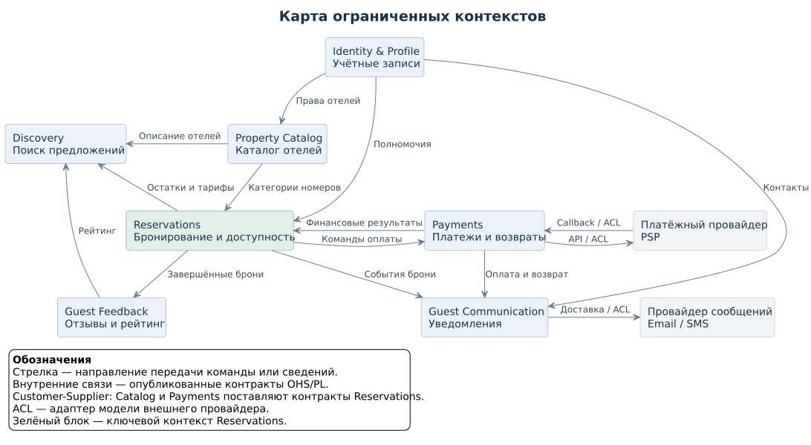
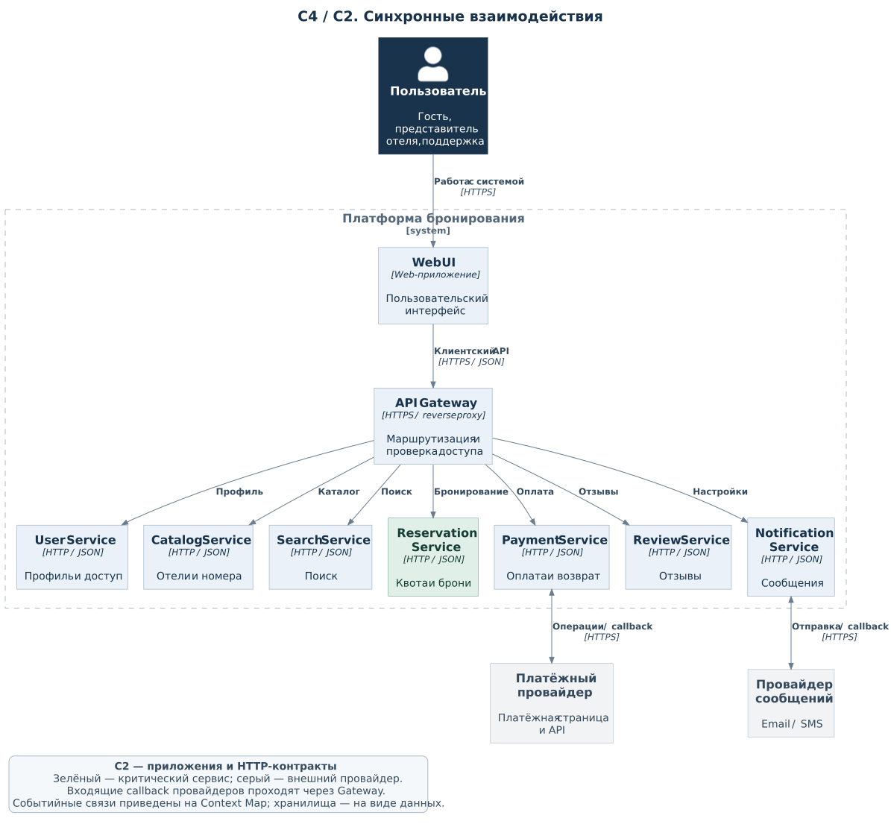
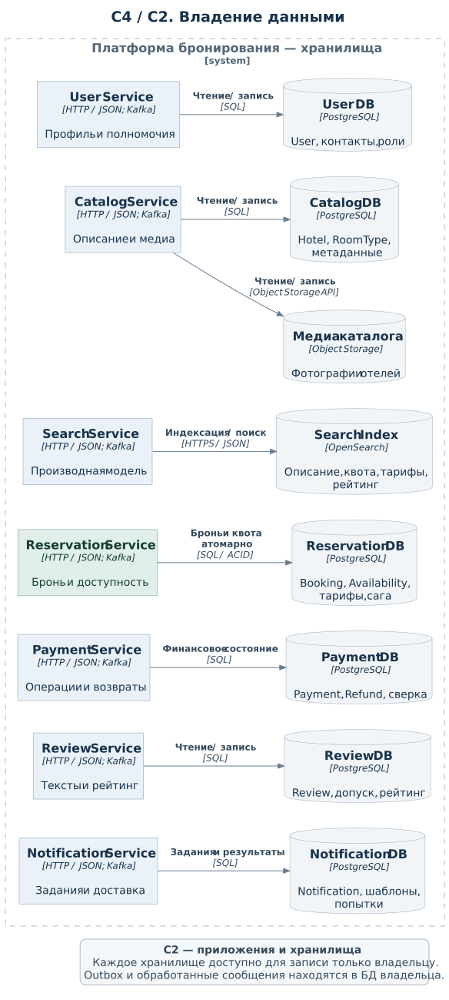

# Лабораторная работа № 1. Декомпозиция системы на микросервисы

**Дисциплина:** «Микросервисная архитектура»  
**Вариант:** 1115  
**Система:** поиск и бронирование гостиничных номеров

<a id="task"></a>

## 1. Условия проектирования

Система должна поддерживать управление пользователями, каталог отелей, поиск номеров, бронирование, оплату, отмену, отзывы и уведомления. Заданы нагрузка 10 000 RPS, круглосуточная доступность критических операций, явное владение данными, независимое масштабирование и развёртывание критического сервиса. Разработку ведут пять команд.

Показатель «10 млн» принят как число зарегистрированных пользователей; единица измерения в задании не уточнена. Для предметной модели приняты следующие правила:

- `Room` — продаваемая категория номера. Отель выделяет платформе квоту, которую другие каналы не расходуют независимо.
- Одна бронь относится к одному отелю и категории, содержит количество номеров и даты проживания. День выезда не занимает номер.
- Перед оплатой номера удерживаются на 15 минут. Цена и правила отмены сохраняются в брони; оплата требуется полностью.

Критический сервис — Reservation Service. Его основное ограничение: бронь и занятая ею квота должны изменяться согласованно.

<a id="contexts"></a>

## 2. Границы контекстов

*Таблица 1 — Bounded contexts и микросервисы*

| Контекст | Сервис | Область модели |
|---|---|---|
| Identity & Profile | User Service | Учётные записи, профиль и полномочия |
| Property Catalog | Catalog Service | Описание отелей и категорий номеров |
| Discovery | Search Service | Поиск и производная модель предложений |
| Reservations | Reservation Service | Доступность, удержания, брони и отмены |
| Payments | Payment Service | Платежи, возвраты и операции провайдера |
| Guest Feedback | Review Service | Отзывы, модерация и рейтинг |
| Guest Communication | Notification Service | Задания и результаты доставки сообщений |

`Hotel` и `Room` объединены в каталоге, поскольку описывают размещение. `Booking` и `Availability` принадлежат Reservation: удержание всех ночей, подтверждение и освобождение квоты выполняются локальными транзакциями. Отмена остаётся операцией над бронью. Поиск выделен из-за преобладания чтения и использования отдельного индекса.

### 2.1. Context Map



*Рисунок 1 — Контексты и направления взаимодействия*

[PlantUML](diagrams/context-map.puml)

Внутренние контракты опубликованы как API или схемы сообщений — OHS/PL. В отношениях Customer–Supplier каталог поставляет модель категорий для Reservation, а Payment предоставляет ему финансовые операции. Адаптеры ACL внутри Payment и Notification переводят контракты внешних провайдеров в модели этих сервисов.

<a id="catalog"></a>

## 3. Каталог микросервисов

Каждый сервис изменяет только собственные данные. Чужие сведения получает через API или события; прямой доступ к чужим таблицам и межсервисные внешние ключи не используются. API доступны через HTTPS; служебные операции проверяют права на конкретный отель или роль.

### 3.1. User Service

**Ответственность:** регистрация, вход, профиль, подтверждённые контакты и роли.

**Данные:** `User`, контакты, сессии, полномочия и привязки представителей к отелям. Хранилище — PostgreSQL. Владелец — T1.

**API:**

```text
POST /users
POST /sessions
GET  /users/me
PATCH /users/me
```

**Зависимости и связь:** HTTP/JSON для клиента; Kafka для изменений контактов и полномочий. Остальные сервисы проверяют токены по кэшированным публичным ключам.

**Масштабирование:** горизонтальные реплики API, отдельные лимиты входа и чтения профилей.

### 3.2. Catalog Service

**Ответственность:** карточки отелей, категории номеров, характеристики, фотографии и публикация.

**Данные:** `Hotel`, `Room` / `RoomType`, описание и метаданные медиа. PostgreSQL и объектное хранилище фотографий. Владелец — T2.

**API:**

```text
GET   /hotels/{id}
PATCH /hotels/{id}
GET   /hotels/{id}/room-types
POST  /hotels/{id}/room-types
```

**Зависимости и связь:** полномочия User; HTTP/JSON; события изменения отеля и категории для Search и Reservation. Квоту не изменяет.

**Масштабирование:** реплики чтения, кэш карточек и CDN для фотографий; редакторские операции масштабируются отдельно от публичного чтения.

### 3.3. Search Service

**Ответственность:** поиск по направлению, датам, вместимости, цене и рейтингу.

**Данные:** поисковые документы, версии проекций и настройки ранжирования в OpenSearch. Владелец — T2.

**API:**

```text
GET /search/hotels?destination=...&check_in=...&check_out=...&guests=...
GET /search/suggestions?query=...
```

**Зависимости и связь:** события Catalog, Reservation и Review поступают через Kafka; клиентские запросы — HTTP/JSON. Выдача не вызывает владельцев данных для каждого найденного отеля.

**Масштабирование:** независимые реплики API и индексаторов, шарды и реплики индекса. Доступность в выдаче предварительная; окончательную проверку выполняет Reservation.

### 3.4. Reservation Service

**Ответственность:** квота, тарифы, предложения, удержания, создание и подтверждение брони, отмена, истечение удержаний и расчёт возврата.

**Данные:** `Booking`, `Availability`, суточные остатки, тарифы, снимки условий, отмены и состояние платёжной саги. Отдельная БД PostgreSQL. Владелец — T3.

**API:**

```text
POST /quotes
POST /bookings
GET  /bookings/{id}
GET  /users/me/bookings
POST /bookings/{id}/cancel
PUT  /hotels/{id}/inventory
PUT  /hotels/{id}/rates
```

**Зависимости и связь:** локальные проекции категорий Catalog и прав User; HTTP/JSON для клиента; Kafka для команд Payment и событий брони. Создание удержания не требует синхронного вызова Catalog, User или Notification.

**Масштабирование:** реплики API без локального состояния и отдельные пулы таймеров. При необходимости данные разделяются по отелю, чтобы бронь и все её ночи оставались в одной транзакционной БД.

### 3.5. Payment Service

**Ответственность:** платёжная сессия, проверка callback, финансовые статусы, возвраты и сверка с провайдером.

**Данные:** `Payment`, попытки, возвраты, идентификаторы провайдера и история сверки. Отдельная БД PostgreSQL. Владелец — T4.

**API:**

```text
GET  /payments/by-booking/{id}
GET  /payments/{id}
POST /webhooks/psp
```

**Зависимости и связь:** команды Reservation через Kafka; HTTP/JSON для клиента; HTTPS API и подписанные callback платёжного провайдера. Сумму задаёт Reservation. Карточные реквизиты вводятся у провайдера.

**Масштабирование:** отдельные пулы API, callback и сверки с ограничением исходящего потока по квотам провайдера.

### 3.6. Review Service

**Ответственность:** допуск к отзыву, публикация, редактирование, модерация и рейтинг.

**Данные:** `Review`, допуски по завершённым броням, статусы модерации и агрегаты рейтинга в PostgreSQL. Владелец — T1.

**API:**

```text
POST  /reviews
PATCH /reviews/{id}
GET   /hotels/{id}/reviews
```

**Зависимости и связь:** событие завершения брони от Reservation, HTTP/JSON для клиента, события рейтинга для Search через Kafka. Один отзыв разрешён владельцу одной завершённой неотменённой брони.

**Масштабирование:** реплики чтения и кэш; модерация и пересчёт рейтинга выполняются фоновыми обработчиками.

### 3.7. Notification Service

**Ответственность:** сообщения о брони, оплате, отмене и возврате; шаблоны, повторы и результаты доставки.

**Данные:** `Notification`, задания, шаблоны, подтверждённые контакты и попытки доставки в PostgreSQL. Владелец — T1.

**API:**

```text
GET /users/me/notifications
PATCH /users/me/notification-preferences
POST /webhooks/message-provider
```

**Зависимости и связь:** события User, Reservation и Payment через Kafka; HTTPS API провайдера email/SMS. Подтверждение брони не ожидает доставки сообщения.

**Масштабирование:** независимые очереди и обработчики каналов с учётом лимитов провайдера.

<a id="interaction"></a>

## 4. Основные взаимодействия

**Поиск.** Search получает описание из Catalog, доступность и тарифы из Reservation, рейтинг из Review. Для брони на несколько ночей проверяется наличие на каждую ночь. При выборе предложения клиент запрашивает актуальные условия у Reservation.

**Бронирование.** Reservation блокирует суточные остатки в едином порядке. Если хотя бы одной ночи не хватает, операция откатывается полностью. Иначе в одной транзакции создаются бронь `HELD`, удержание квоты и сообщение `CreatePayment`. Цена и правила отмены сохраняются в брони.

**Оплата.** Payment создаёт сессию провайдера по идентификатору брони, сумме и валюте. После проверенного успешного callback публикует `PaymentSucceeded`. Reservation подтверждает бронь только при совпадении суммы и валюты и действующем удержании: количество переносится из удержанного в подтверждённое.

**Отмена.** Reservation проверяет владельца и условия, переводит бронь в `CANCELLED` и освобождает квоту одной транзакцией. При необходимости отправляет `RequestRefund`. Возврат завершается отдельно; до его подтверждения сохраняется финансовый статус ожидания.

**Повторы и сбои.** Создание, отмена и финансовые команды имеют ключи идемпотентности. Изменение данных и outbox сохраняются атомарно; потребитель регистрирует обработанное сообщение вместе со своим изменением. Неизвестный результат списания сверяется по исходной операции, без нового независимого платежа.

Если оплата приходит после истечения или отмены удержания, бронь не восстанавливается: формируется полный возврат. Подтверждение, истечение и отмена блокируют одну запись Booking, поэтому квота освобождается однократно. Оркестратор этой саги — Reservation.

<a id="constraints"></a>

## 5. Выполнение архитектурных ограничений

**Нагрузка и масштабирование.** Для оценки принят профиль с 80 % поисковых запросов: 8 000 из 10 000 RPS обслуживает Search. Это расчётное допущение. Его реплики и индекс масштабируются независимо от транзакционной БД бронирований. Дополнительные реплики Reservation не устраняют конкуренцию за последние номера одной категории.

**Доступность 24/7.** Критические API работают в нескольких экземплярах по зонам отказа; БД бронирований и платежей используют репликацию и переключение лидера. Отказ доставки сообщений не останавливает бронь. При недоступности платёжного провайдера оплата ожидает результата в пределах срока удержания; после истечения квота освобождается.

**Независимый выпуск.** Reservation имеет собственный артефакт, БД и миграции. Обновление выполняется постепенно при совместимых версиях API и событий. Его выпуск не требует одновременного обновления соседних сервисов.

*Таблица 2 — Ответственность пяти команд*

| Команда | Ответственность |
|---|---|
| T1. Гостевой опыт | User, Review и Notification |
| T2. Предложение и поиск | Catalog и Search |
| T3. Бронирование | Reservation, квота и состояние саги |
| T4. Платежи | Payment, провайдер, возвраты и сверка |
| T5. Платформа | Gateway, брокер, инфраструктура БД, развёртывание и наблюдаемость |

Владельцы сервисов управляют схемами и бизнес-правилами своих данных. T5 обслуживает инфраструктуру и не изменяет бизнес-записи вместо владельца.

<a id="adr"></a>

## 6. ADR-001. Бронирование и доступность в одном сервисе

**Статус:** принято.

### 6.1. Контекст и альтернативы

Создание брони занимает квоту сразу на все ночи. Разделение этих записей между сервисами превращает локальный инвариант в распределённый протокол. При этом критический сервис должен выпускаться независимо, а поисковая нагрузка — масштабироваться отдельно.

Рассмотрены два варианта помимо выбранного:

1. **Модульный монолит.** Упрощает транзакции и эксплуатацию, но единый артефакт связывает выпуск критического сервиса с остальными модулями. Условие независимого развёртывания не выполняется.
2. **Отдельные Booking Service и Inventory Service.** Позволяют независимо развивать управление остатками. Для продажи нужны идемпотентные удержания с `hold_id`, сроки, подтверждение, освобождение и сверка. Сбой между резервированием и записью брони оставляет незавершённое распределённое состояние.

### 6.2. Решение и последствия

Выбраны семь сервисов с объединением `Booking` и `Availability` в Reservation. Это сохраняет атомарность квоты и брони, допускает независимый выпуск критического контура и отделяет поиск от записи продаж. Платёжная операция остаётся отдельной, поскольку зависит от внешнего провайдера и собственного финансового состояния.

**Положительные последствия:** локальная защита от перепродажи выделенной квоты, явные владельцы данных, независимые масштабирование и выпуск Search, Reservation и Payment.

**Отрицательные последствия и проблемы:**

- Поисковая проекция отстаёт: выбранное предложение может быть отклонено при окончательной проверке.
- Популярная категория создаёт конкуренцию за одни остатки; рост числа реплик не снимает это ограничение.
- Поздняя оплата требует возврата, а не отката брони. Нужны сохранённое состояние саги, повторы и сверка.
- Сервисы требуют совместимых контрактов и эксплуатации брокера. Несовместимое изменение события связывает выпуски команд.
- При расходовании той же квоты внешними каналами локальная транзакция не предотвращает общую перепродажу; нужна согласованная интеграция с системой отеля.

### 6.3. Итоговая архитектура C4



*Рисунок 2 — C4 C2: приложения и клиентские вызовы*

[PlantUML](diagrams/c4-applications.puml)

Gateway маршрутизирует HTTP-запросы. Команды оплаты и события изменения данных передаются через Kafka по связям Context Map. Хранилища показаны отдельно, чтобы не перегружать схему приложений.



*Рисунок 3 — C4 C2: владельцы хранилищ*

[PlantUML](diagrams/c4-data.puml)
